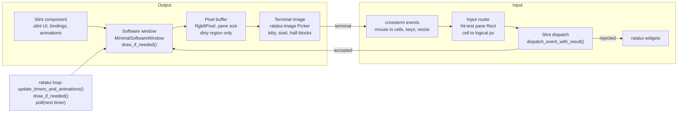

# Slint inside ratatui — implementation plan

2026-10-11 · Till Adam · revised the same day after a Codex plan review against the spike and the pinned crate sources, then updated with implementation results

## Implementation status (2026-10-11)

The crate, all four example programs and the test harness are uncommitted, in the working tree of the local `implement-plan` branch. Everything that can be checked without a real terminal is checked; everything that needs one is not.

| Phase | Status | Evidence |
| --- | --- | --- |
| 1. Crate core | Done, headless-verified | `tests/phase1.rs`, `tests/invoke_from_event_loop.rs`: two panes, resize, registry empty after drop, cross-thread wake, idle loop blocks with no timeout, frame cap, stable kitty image id, font-size change re-renders at the new cell size |
| 2. Input and focus | Done, headless-verified | `tests/input.rs`: typing, Ctrl shortcuts, copy (OSC 52) and paste in `LineEdit`; multi-line `TextEdit`; `ComboBox` popup pick; drag capture with negative coordinates; popup closes on click outside the pane; rejected keys reach ratatui; key kinds with and without the kitty keyboard protocol |
| 3. Output and bandwidth | Code done; real-terminal criteria unverified | `tests/output.rs`, `examples/bench.rs`. Idle writes zero bytes in steady state (measured under the fake terminal, half-blocks and kitty). Kitty compression cut sysmon's output from 207.8 MB to 3.8 MB over 6 s (measured at the pseudo-terminal; decode and compression CPU cost not measured). Not done: 30 fps on a real kitty, SSH budget, partial-update prototype |
| 4. Hardening and release | Partly done | Done: snapshot test, headless test suite, fake-terminal smoke matrix (`scripts/smoke.sh`, 3 protocols × 4 programs plus panic restore), CI workflow (not yet run), README. Not done: real terminal matrix, tmux, publishing |

Deviations from this plan, each found during implementation:

- Example 1 uses an original 800 × 480 panel instead of Slint's demo `.slint` files. Copying the demos into an MIT repository needs their licence and assets checked first.
- The public `slint` crate only enables image decoding through its windowing backends. The crate therefore adds a feature-only dependency on `i-slint-core` (`image-decoders`, `svg`), default-on behind its own `image-decoders` feature. No `i-slint-core` API is used.
- `Runtime::timeout()` fires due timers itself, and samples Slint's animation flag before advancing the clock. Slint clears that flag on every tick and sets it again only during the next render.
- Leaving a pane uses Ctrl+G by default, configurable. The open question about the key remains.
- Cell size is re-read on terminal resize through the window-size ioctl (`terminal::cell_size()`), not by re-running the startup query, because the input thread owns stdin. Terminals or multiplexers that report zero pixel sizes keep the startup size.
- Compression is the biggest bandwidth lever found so far, so it may make partial updates unnecessary for the SSH budget. That depends on the budget and on real decode cost.

## Goal and scope

Build a reusable Rust crate that embeds Slint components as pixel widgets inside a ratatui application, using only Slint's public platform API. A working spike against slint 1.18.1, ratatui 0.30.2 and ratatui-image 11.1.0 already renders, animates and takes clicks and keys, so the remaining work is engineering, not feasibility.

In scope:

- One or more Slint components per ratatui app, each owning a ratatui `Rect`.
- Output through ratatui-image (kitty, sixel, iTerm2, half-blocks), chosen per terminal.
- Animations, timers and property bindings driven from the ratatui loop.
- Mouse and keyboard routed to the pane under focus, with unconsumed keys falling back to ratatui.

Non-goals:

- A cell-native Slint renderer or TUI widget style.
- Running arbitrary existing Slint GUIs unchanged in a terminal.
- Native popups or separate top-level windows; popups stay inside their pane.
- C++, Python or JS hosts; ratatui is Rust-only.

## Architecture

The crate installs a custom Slint platform that gives every component a software-rendered window, and the ratatui loop drives Slint's clock, rendering and input; Slint never runs its own event loop.

Output runs left to right, from the Slint component to an image in the pane's `Rect`. Input comes back through crossterm, is hit-tested against the pane and dispatched to Slint; keys Slint rejects fall through to ratatui widgets.

## Verified API surface

Every item below was read in the crate sources and exercised in a compiled spike; nothing relies on `i-slint-core` internals. Cargo features used: slint with `default-features = false` plus `std`, `compat-1-2`, `renderer-software`, `software-renderer-systemfonts`, `software-renderer-path`; ratatui-image with `default-features = false` plus `crossterm`, `image-defaults` (drops the chafa `pkg-config` dependency).

| Need | API (slint 1.18.1 / ratatui-image 11.1.0) | Spike result |
| --- | --- | --- |
| Install the platform | `slint::platform::set_platform(Box<dyn Platform>)`; only `create_window_adapter` must be implemented | One call per thread (the context is thread-local); errors with `AlreadySet` after that. The event-loop proxy slot is process-wide, so only the first platform in a process receives `invoke_from_event_loop` |
| Window per component | `MinimalSoftwareWindow::new(RepaintBufferType::ReusedBuffer)` returned from `create_window_adapter` | One component tested; two panes are a Phase 1 exit test. `Window::show()` stores a strong component reference that only `hide()` releases, so a pane must hide on drop |
| Size to the cell area | `window.set_size(PhysicalSize)` with cells × terminal font pixel size | 38 × 9 cells → 380 × 180 px at a 10 × 20 font |
| Drive time | `slint::platform::update_timers_and_animations()`, `duration_until_next_timer_update()`, `Window::has_active_animations()` | `animation-tick()` and `animate width` both ran off the ratatui loop. `has_active_animations()` is per thread and reset by every clock advance; sample it between render and the next update |
| Render | `draw_if_needed(\|r\| r.render(&mut [slint::Rgb8Pixel], stride))` → returns the dirty `PhysicalRegion` | Redraws only when Slint marks the window dirty |
| Encode | `Picker::from_query_stdio()` or `Picker::halfblocks()`, then `picker.new_protocol(DynamicImage, Size, Resize::Fit(None))` → `Image` widget | Pixel size equals the cell box, so no resize step runs for pixel protocols; half-blocks always downsample to cells × 2 rows. The stateful variant (`new_resize_protocol`) keeps one kitty image id across re-encodes, and `QueryStdioOptions::kitty_compression` probes for compression; neither is used by the spike yet |
| Pointer input | `window.dispatch_event(WindowEvent::PointerPressed / PointerReleased / PointerMoved / PointerScrolled)` at logical coordinates | Two clicks → `clicks = 2` |
| Key input with fallback | `window.dispatch_event_with_result(WindowEvent::KeyPressed { text })` → `WindowEventDispatchResult::Accepted` or `Rejected`; special keys via `slint::platform::Key` → `SharedString` | `+` accepted by a `FocusScope`, `x` rejected and free for ratatui. Tab, Backtab and Escape are consumed by `WindowInner::process_key_input` for focus traversal and popup dismissal and never come back as `Rejected` |
| Popups | No native popup support in `MinimalSoftwareWindow`, so core places them as child popups clipped to the window | Read in `WindowInner::show_popup`; not yet exercised |
| Clipboard | `Platform::set_clipboard_text` for copy and `Platform::clipboard_text` for paste; both default to no-ops | Not exercised; paste needs a local cache since terminals cannot be read back |
| Wake-ups from other threads | `Platform::new_event_loop_proxy` backs `invoke_from_event_loop` and `spawn_local`; the default returns `None` | Not exercised; the spike only wakes on crossterm input or timer expiry |

Measured on the build container (x86-64, release build), a 120 × 30 cell pane (1200 × 600 px) with a small animated element:

| Protocol | Slint render per frame | Encode + widget per frame | Cell payload per frame |
| --- | --- | --- | --- |
| Half-blocks | 0.18 ms | 6.6 ms | ~3 KB glyphs, plus colour escapes for changed cells |
| Sixel | 0.05 ms | 75 ms | ~6 KB |
| Kitty, uncompressed | 0.04 ms | 4.3 ms | ~3.7 MB |

Render cost is low because `ReusedBuffer` repaints only the dirty region; a full-pane change will cost more. The bottleneck is the protocol: sixel encoding caps out near 13 fps, and uncompressed kitty re-sends the whole RGBA image every frame.

Caveat: the spike's `bench()` measures Slint render, encode and ratatui buffer symbol size only. Bytes actually written by the terminal backend, terminal decode time and the diffed cell payload were not measured.

`examples/bench.rs` now measures bytes at the crossterm writer, after ratatui's diff. Measured 2026-10-11 on an Apple Silicon Mac, release build, same 1200 × 600 px pane with a small moving element, 30 frames. Different machine from the table above, so compare within a table, not across them. Terminal decode time is still not measured.

| Protocol | Slint render | Snapshot (UI thread) | Encode | Bytes per frame at the writer |
| --- | --- | --- | --- | --- |
| Half-blocks | 0.02 ms | 4.6 ms | 1.4 ms | 453 |
| Sixel | 0.02 ms | 3.9 ms | 15.2 ms | 1,999 |
| Kitty, uncompressed | 0.01 ms | 4.9 ms | 0.5 ms | 3,852,297 |
| iTerm2 | 0.01 ms | 5.5 ms | 0.8 ms | 21,541 |

New finding: the per-frame snapshot (framebuffer copy, image construction and ratatui-image's source hash) costs 4–6 ms on the UI thread at this size. That is more than render and, except for sixel, more than encode. It caps a single pane near 200 fps on this machine, which is fine for 30 fps, but it is the first thing to optimise for several large panes.

## Phased plan

Four phases after the spike, roughly 18–24 engineer-days in total; effort figures are estimates, not measurements.

| Phase | Deliverable | Exit criterion | Effort (est.) |
| --- | --- | --- | --- |
| 0. Spike | Single-file demo: platform, one pane, half-block/kitty output, click and key routing | Done 2026-10-11: renders, animates, `Accepted`/`Rejected` key fallback works | 1 day |
| 1. Crate core | `SlintPlatform` with a registry of weak window references and an `EventLoopProxy` so other threads can wake the loop; `SlintPane<C: ComponentHandle>` built by a fallible factory closure, hiding its window on drop; a ratatui `StatefulWidget` that sizes and draws the pane; a `SlintDriver` that returns the next poll timeout and drains the wake queue; one terminal frame per loop cycle | Two panes in one app, terminal resize handled, dropped panes leave the registry empty, `invoke_from_event_loop` from a second thread wakes the loop | 4–5 days |
| 2. Input and focus | Full pointer set (move, hover, drag with capture by the pressed pane, wheel, `PointerExited`); key map incl. modifiers and press/repeat/release kinds; a host-reserved shortcut for leaving a pane; pane focus integrated with ratatui focus incl. `WindowActiveChanged`; clipboard copy via OSC 52 and paste via a local cache plus crossterm bracketed paste | `LineEdit`, `TextEdit` and a `ComboBox` popup usable inside a pane; unconsumed keys reach ratatui; a drag that leaves the pane still delivers its release to that pane; popup dismisses on a click outside the pane | 4–5 days |
| 3. Output and bandwidth | Protocol selection; scale-factor policy separate from font size, delivered via `ScaleFactorChanged`; opaque panes first, transparency behind a feature flag; kitty compression enabled through ratatui-image's probe and measured; stateful kitty protocol for a stable image id; frame cap with absolute deadlines; encoding on a worker with latest-frame coalescing and stale-result rejection | Terminal matrix and SSH budget fixed before the phase starts; idle UI writes zero bytes, measured at the backend writer; local kitty sustains 30 fps on a 1200 × 600 pane; SSH budget met | 5–8 days |
| 4. Hardening and release | Terminal test matrix incl. tmux; snapshot tests on `TestBackend`; headless harness with lifecycle and input assertions instead of printed observations; panic-safe terminal restore; examples and docs | Matrix green on the agreed terminals; crate published | 4–5 days |

Phase details worth fixing early:

1. Window ownership. The spike hands each new window to the caller through a `last_created` slot, which is ambiguous as soon as a component creates nested components. `ComponentHandle` has no generic constructor, so the pane constructor takes a fallible factory closure, then finds its window by matching `component.window()` against the registry. `SlintPane::drop` calls `hide()`, which releases the strong component reference held since `show()`, and removes routing state; the registry holds only weak references.
2. Loop integration. Poll timeout = the smaller of `duration_until_next_timer_update()` and a frame interval when any window `has_active_animations()`; otherwise block until input. `has_active_animations()` is process-wide in 1.18.1, not per window. Blocking on crossterm alone is not enough: encoder completion, file watches for the live-preview example and application data updates need a wakeable queue, so the platform implements `new_event_loop_proxy` and the driver drains the queue each cycle. The spike also draws the terminal twice per iteration, once for layout and once after encoding; kitty transmit state mutates during widget render, so the crate must establish pane geometry, render and encode, then compose one frame. Layout invalidation (pane moved, hidden, zero-sized) is tracked separately from Slint's dirty flag.
3. Pixel coordinates. crossterm reports mouse positions in cells, so hit-testing resolves to cell centres. Sub-cell precision needs SGR-Pixels mouse mode (1016) and a parser outside crossterm; decide in Phase 2 whether it is worth it.
4. Key kinds and modifiers. crossterm reports Ctrl, Alt and Shift on ordinary key events without the kitty keyboard protocol, so the router synthesizes Slint modifier press and release around each key and clears that state on terminal focus loss. The real gap is `KeyEventKind`: the spike always sends an immediate `KeyReleased`, which breaks on terminals that report press, repeat and release separately. Standalone modifier presses and key release still need the enhancement flags.
5. Partial updates. Slint already returns the dirty region. The spike's one-shot `new_protocol` gets a fresh kitty id per frame, but ratatui-image's stateful protocol keeps its id across `resize_encode`, and compression is one query option away; measure both before writing any encoder. Retransmitting under the same id replaces the image and drops placements, so true rectangle updates go through kitty's animation-frame commands, which fewer terminals support. Treat partial updates as a prototype gate on the chosen terminals, not as the assumed SSH mitigation.
6. Reserved keys. Slint consumes Tab, Backtab and Escape at window level, so they cannot fall back to ratatui. The crate defines a host-reserved shortcut that leaves the pane before dispatch (default Ctrl+G), and sends `WindowActiveChanged` on focus transitions.
7. Pointer capture. Drag movement and release go to the pane that received the press even outside its `Rect`; the cell-to-logical conversion must handle negative offsets (the spike's `to_logical` uses unsigned subtraction). Leaving during a drag and ending the interaction are different events; `PointerExited` clears Slint hover and grab state.
8. Scale factor. Terminal font size fixes the physical pane size only. Logical scaling is a user-facing setting, applied with `ScaleFactorChanged`, re-checked after font changes, with checked arithmetic for zero and oversized values.
9. Transparency. Slint renders premultiplied RGBA and image encoders expect straight alpha; half-blocks drop alpha entirely. Ship opaque panes first and composite over a configured background for fallback protocols later.
10. Worker encoding. Windows and components stay on the owning thread; workers receive owned pixel snapshots tagged with a generation. Coalesce to the latest frame, reject results after a resize or drop, keep the last valid frame on screen while encoding, and use absolute deadlines for the frame cap so input bursts cannot defeat it.

## Showcase examples

Three examples ship with the crate; the device console is the headline because it shows the one argument ratatui alone cannot make: one UI definition serving both a touchscreen and a remote console.

| Example | What it shows | Built from | Needs | Main weakness |
| --- | --- | --- | --- | --- |
| 1. Device remote console (headline) | A ratatui operations console (logs, process table, config editor) with the device's real Slint panel live and clickable in a pane; kitty quality locally, half-block fallback over SSH | Planned: Slint's `energy-monitor` or `home-automation` demo, unchanged. Built: an original 800 × 480 panel (licence and assets of the demos not yet checked) | Phases 1–3 | The demos are laid out for a fixed touchscreen, so the pane must be large or the panel scaled; over half-blocks the panel text is unreadable, so the example needs a defined reduced mode (panel scaled, status text in ratatui cells) rather than claiming the unchanged UI stays usable |
| 2. btop-style system monitor | ratatui process table beside Slint panes with anti-aliased, animated gauges and history graphs; zero bytes sent while idle | Own `.slint` gauges, system data from a crate such as `sysinfo` | Phases 1 and 3 | Argues "nicer graphs", which ratatui-image plus a plotting crate partly covers |
| 3. Terminal live preview | `.slint` files hot-reloaded into a pane next to Helix or Neovim, for designing embedded UIs on a board without a display | `slint-interpreter`: `Compiler::build_from_path()` then `ComponentDefinition::create()`, re-run on file change | Phases 1–2, plus tmux support from Phase 4 | Depends on images surviving tmux and terminal splits, the most fragile path |

Build order:

1. Example 2 first, as the Phase 1 and Phase 3 test bed: it exercises animation, frame capping and idle behaviour with no external dependencies.
2. Example 1 next, as the public demo, recorded in kitty or Ghostty, with a second take over SSH to show the fallback.
3. Example 3 last, once the Phase 4 terminal matrix confirms tmux works.

The interpreter path now runs: `examples/live-preview` builds with `slint-interpreter` without any windowing backend, instances use the crate's platform, and the smoke test edits the watched file and checks the reload. tmux is still untested.

## Risks and constraints

The main risk is output bandwidth for animated panes over SSH; the rest are manageable with fallbacks.

| Risk | Impact | Mitigation |
| --- | --- | --- |
| Kitty re-sends the full image each frame (~3.7 MB at 1200 × 600) | Animation over SSH unusable; terminal memory churn from new image ids | Enable ratatui-image's kitty compression probe, use the stateful protocol for a stable id, frame cap, render only on dirty; partial updates only if the animation-frame prototype works on the target terminals |
| Partial kitty updates unsupported on target terminals | No SSH mitigation beyond compression and the frame cap | Decide the SSH budget before Phase 3; if partial updates fail the prototype, scope SSH to half-blocks or a lower frame cap |
| Pane lifetime | Components kept alive by `show()` after the pane is dropped; registry grows | Hide on drop, weak registry, registry-empty assertion in the Phase 1 exit test |
| Sixel encoding ~75 ms per 1200 × 600 frame | About 13 fps ceiling and UI-thread stalls | Encode on a worker thread; prefer kitty or half-blocks where available |
| Half-block resolution is one cell = 1 × 2 pixels | Text inside the pane is unreadable | Treat half-blocks as a coarse fallback; keep text in ratatui cells, not in the Slint pane |
| tmux and other multiplexers | Images missing or misplaced | Rely on ratatui-image's tmux detection and kitty Unicode placeholders; test explicitly |
| Cell pixel size unknown or fractional | Blurry scaling or seams at pane edges | Size the render to the queried font size exactly; fall back to 10 × 20 when the query fails |
| `set_platform` is per thread, the event-loop proxy per process | A second Slint backend on another thread steals or is denied `invoke_from_event_loop`; tests on parallel threads each get a platform but only one proxy | Document; `Runtime::waker()` works for every runtime; tests that need the proxy run in their own binary |
| UI-thread snapshot cost (4–6 ms per 1200 × 600 frame, measured) | Several large animated panes compete for the UI thread | Move the copy and hash to the encoder thread, or skip unchanged rows using Slint's dirty region |
| Feature-only dependency on `i-slint-core` | Breaks if Slint renames the `image-decoders` or `svg` features | Caret requirement unifies with Slint's exact pin; ask upstream to expose the features on `slint` |
| Upstream API movement (ratatui-image 12 is in release candidate) | Breaking changes in `Picker` and protocol APIs | Pin versions; budget a port when 12.0 ships |
| Licensing | Slint is GPL-3.0, royalty-free or commercial; ratatui is MIT | Decide the crate's own licence and which Slint licence users need, especially on embedded devices |

## Open questions

- [ ] Primary use case: embedded-device SSH console, developer tool, or general-purpose crate? It sets the terminal matrix and the bandwidth budget.
- [ ] Ownership: standalone open-source crate, Slint upstream example, or ratatui ecosystem crate?
- [x] Licence of the crate itself: MIT, decided 2026-10-11. Still open: guidance on the Slint licence users need.
- [ ] Target terminals and whether tmux is a must-have. Must be answered before Phase 3 starts, not Phase 4; it decides what the bandwidth work targets.
- [ ] SSH bandwidth budget for an animated pane. Must be answered before Phase 3 starts; it decides whether the partial-update prototype is needed at all.
- [ ] Is sub-cell mouse precision (SGR-Pixels mode) worth a custom input parser?
- [ ] Which key leaves a pane, given Slint keeps Tab, Backtab and Escape?
- [ ] Logical scale factor: fixed 1.0, user setting, or derived from pane size?
- [ ] Wait for ratatui-image 12.0 before Phase 1, or port later?

## Sources

- Spike: `spike/` next to this file, `cargo run -- headless` or `cargo run` in kitty/Ghostty/WezTerm (crates locked at slint 1.18.1, ratatui 0.30.2, ratatui-image 11.1.0, crossterm 0.29.0)
- Living version of this plan: https://claude.ai/code/artifact/79aecf99-fab0-4449-8c7e-c29efe26ae98
- [Render slint in Terminal window, Slint Discussion #4672](https://github.com/slint-ui/slint/discussions/4672)
- [Terminal device for the MCU backend, commit 5cdc70a](https://github.com/slint-ui/slint/commit/5cdc70a027e5460c4528964914dcbbdb79538d70)
- [ratatui-image repository](https://github.com/ratatui/ratatui-image)
