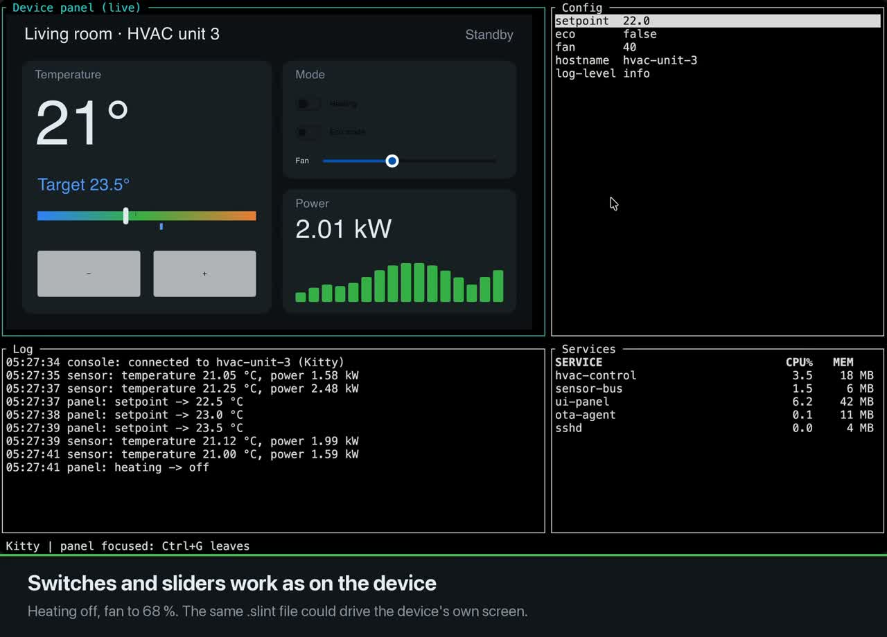

# ratatui-slint

Embed [Slint](https://slint.dev) components as pixel widgets inside a
[ratatui](https://ratatui.rs) application.

Slint renders each component with its software renderer into a framebuffer the size of the pane.
The frame is shown through [ratatui-image](https://github.com/ratatui/ratatui-image) as kitty,
sixel, iTerm2 or half-block output. The ratatui loop drives Slint's timers, animations and
rendering, and Slint never runs its own event loop. Mouse and keyboard input goes to the pane
under the pointer or in focus, and keys Slint rejects fall back to ratatui.

[](docs/demo.mp4)

[Watch the 50-second demo](docs/demo.mp4), recorded in kitty on macOS.

Status: pre-release. The headless tests pass, and every example passes scripted checks under a
simulated terminal. The examples have been run by hand in kitty, Ghostty, WezTerm, iTerm2 and
Terminal.app. tmux and SSH are untested. See [PLAN.md](PLAN.md) for the design, measurements
and what is still open.

## Try it

Clone the repository and run the examples from its root:

```sh
cargo run --release --example hello            # one pane filling the terminal
cargo run --release --example sysmon           # process table + animated Slint gauges
cargo run --release --example device_console   # ops console around a live touch panel
cargo run --release -p live-preview            # hot-reloading preview; add -- path/to/ui.slint
```

Click a Slint pane to give it the keyboard, and press Ctrl+G to leave it. `q` quits when no pane
has focus. Each example's keys are listed at the top of its source file in `examples/`.

| Example | Shows |
|---|---|
| `hello` | The smallest complete app. Click the pane, then press `+`/`-`. |
| `sysmon` | A ratatui process table beside Slint per-core gauges, a memory gauge and a CPU graph. `p` pauses sampling: with nothing changing, nothing is redrawn and no bytes go to the terminal. |
| `device_console` | An 800 × 480 touch-panel UI scaled into a pane with `Scale::Fit`, inside a ratatui console with logs and a config editor. |
| `live-preview` | Recompiles a `.slint` file on save and swaps it in. Without a path it shows a bundled demo. `s` cycles the scale, `r` reloads. |
| `termbench` | Runs an animated pane full screen for 5 seconds, then prints fps, per-frame costs and bytes written. |
| `bench` | Per-protocol encode cost and output size, written to memory, so no terminal is needed. |

The `spike/` directory holds the original single-file prototype. It is kept for reference only
and is not maintained; use the examples above instead.

### Terminals

The protocol is detected at startup.

| Terminal | Protocol | Full-screen `termbench` |
|---|---|---|
| kitty | kitty | works |
| Ghostty | kitty, compressed | 33 fps, measured before a later speed-up; smooth since, not re-measured |
| WezTerm | iTerm2 (sixel also works when forced) | 60 fps at 80×24; forced sixel 54 fps |
| iTerm2 | iTerm2 | 14 fps, limited by iTerm2's image decoding |
| Terminal.app | half-blocks | 60 fps, at low resolution |

These numbers were measured once each on a single Mac with a Retina display, so treat them as
rough. Run `termbench` to measure your own terminal.

## Usage

```rust
use ratatui_slint::{InputRouter, LoopEvent, PaneInput, Routed, Runtime, SlintWidget};
use ratatui_slint::terminal::{TerminalOptions, TerminalSession};

slint::slint! { export component Hello inherits Window { Text { text: "hello"; } } }

fn main() -> Result<(), Box<dyn std::error::Error>> {
    let mut rt = Runtime::new()?;                          // installs the Slint platform
    let mut session = TerminalSession::init(TerminalOptions::default())?;
    rt.spawn_terminal_reader();                            // after the terminal queries
    let mut pane = rt.create_pane(&session.picker, Hello::new)?;
    let mut router = InputRouter::new();
    router.set_keyboard_enhanced(session.keyboard_enhanced);
    loop {
        match rt.next_event() {                            // blocks until input, a timer or a frame
            LoopEvent::Terminal(ev) => {
                if router.route(&ev, &[&pane as &dyn PaneInput]) == Routed::Unhandled {
                    // ratatui handles the event; quit on 'q' etc.
                }
            }
            LoopEvent::Quit => break,
            _ => {}
        }
        if rt.begin_frame() {                              // frame cap and idle detection
            let area = session.terminal.size()?.into();
            pane.set_area(area);
            if pane.update() {                             // render + encode only when dirty
                session.terminal.draw(|f| f.render_stateful_widget(SlintWidget, area, &mut pane))?;
            }
        }
        rt.write_pending_output(session.terminal.backend_mut())?; // OSC 52 clipboard
    }
    Ok(())
}
```

Key points:

- **One frame per cycle.** Lay out the panes, call `update`, then draw once. An idle UI makes
  `next_event` block indefinitely and writes nothing to the terminal.
- **Wake-ups from other threads.** `slint::invoke_from_event_loop` and `Runtime::waker` both wake
  the loop.
- **Focus.** Clicking a pane focuses it. Slint keeps Tab and Escape for its own focus chain and
  popups, so Ctrl+G leaves a pane. Change it with `InputRouter::set_exit_key`.
- **Scaling.** The default `Scale::Auto` sets the factor to cell height ÷ 16, so Slint text sizes
  look like terminal text on 1× and Retina displays alike. `Scale::Fixed(f)` maps one logical
  pixel to `f` terminal pixels. `Scale::Fit { width, height }` fits a fixed-size design, such as a
  touch panel, into the pane. `RATATUI_SLINT_SCALE=auto|<number>` replaces the default.
- **Encoding.** Sixel, kitty and iTerm2 encode on a worker thread by default, dropping frames it
  cannot keep up with. Half-blocks encode inline. See `SlintPane::set_encode_mode`.
- **Protocol.** It is detected at startup. iTerm2 gets its own protocol even though it answers
  the kitty query, because raw kitty frames are far slower there. Override it with
  `RATATUI_SLINT_PROTOCOL=halfblocks|sixel|kitty|iterm2`.
- **Kitty compression.** On by default when the terminal accepts it: UI frames compress about
  85-fold for a few milliseconds of encode time, which took Ghostty from 3 to 33 fps full screen.
  Turn it off with `RATATUI_SLINT_KITTY_COMPRESSION=0` or `TerminalOptions::kitty_compression`.
- **Measuring.** `cargo run --release --example termbench` reports fps and where each frame's
  time goes in the terminal it runs in.
- **Font zoom.** On `Event::Resize`, pass `terminal::cell_size()` to `SlintPane::set_font_size`
  so panes follow a changed cell size.

The library requires Rust 1.92 or newer. The system-monitor examples use `sysinfo` and require
Rust 1.95 or newer; use the current stable toolchain for development and the full test suite.

Cargo features:

- `image-decoders` (default) decodes PNG, JPEG and SVG images in `.slint` files, including the
  std-widgets icons.
- `transparency` renders with alpha. Kitty and iTerm2 keep it, and the other protocols composite
  over `SlintPane::set_background`.

## Testing

```sh
cargo test --workspace
./scripts/smoke.sh   # every example under a simulated terminal, per protocol
```

`scripts/fake_terminal.py` runs a program in a pseudo-terminal that answers the startup queries
like a kitty, sixel or plain terminal would. It sends scripted clicks and keys, and checks the
final screen.

## Licence

This crate is MIT licensed, see [LICENSE](LICENSE). Slint itself is available under GPL-3.0, a
royalty-free licence or a commercial licence. Users of this crate pick the Slint licence that fits
their product.
